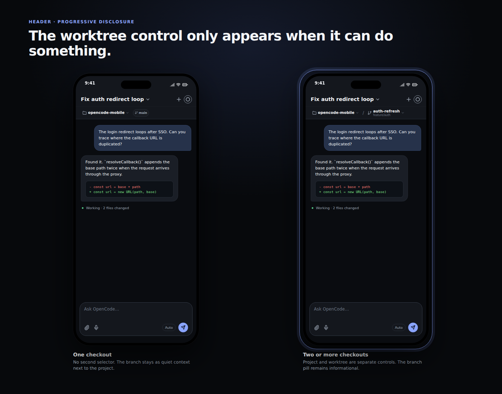
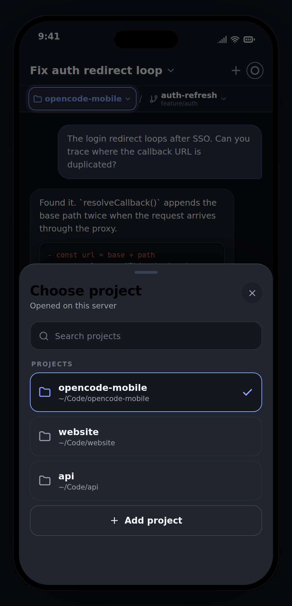
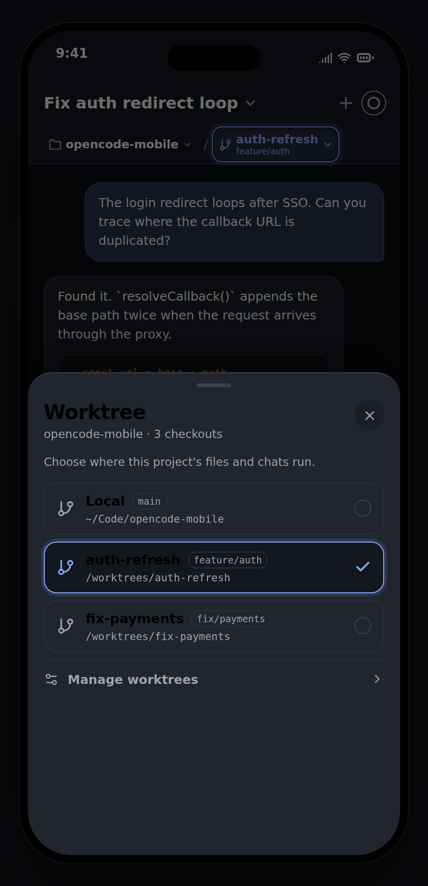
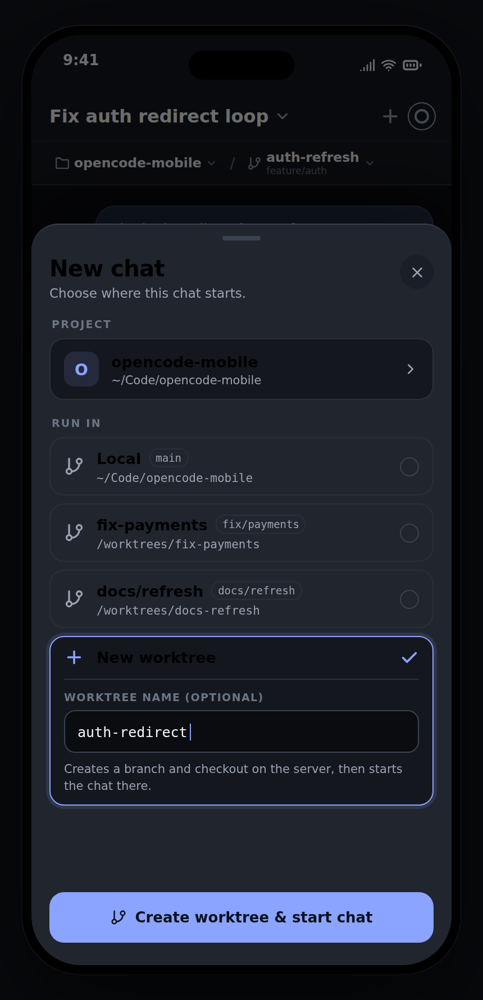
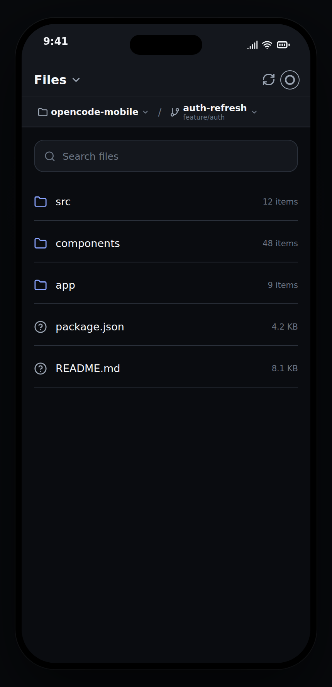

# Worktree UX proposal

Back to the [proposal index](README.md).

Status: **implemented**.

Mocks: [overview](worktree-ux/overview.png) · [header states](worktree-ux/header-states.png) · [project picker](worktree-ux/project-picker.png) · [worktree picker](worktree-ux/worktree-picker.png) · [new chat](worktree-ux/new-chat.png) · [Projects tab](worktree-ux/projects-tab.png) · [15s walkthrough](worktree-ux/worktree-ux-walkthrough.mp4)

## The problem

The current workspace UI mixes two different concepts:

- a **project** is the repository identity (`opencode-mobile`);
- a **worktree** is one checkout of that repository (`Local`, `auth-refresh`, `fix-payments`).

Today `components/ui/project-picker.tsx` renders project rows and then appends
`components/project/worktree-picker.tsx` underneath them. Worktree paths can also
appear as their own project entries because `ConnectionRecord.projects` stores
opened checkout paths. The result is one flat list that mixes:

- choosing a project,
- choosing a checkout of that project,
- creating a checkout,
- removing a checkout.

The New chat sheet has the opposite problem: it only chooses a project. A user
who wants to start in a worktree has to leave the flow, switch the global
workspace first, and then come back. The worktree-specific "Run session in"
dropdown also mixes a destination (`Local`, `Worktree`) with an action
(`New worktree`).

## Recommendation

Use two explicit levels:

1. **Project** — always selectable. Project pickers contain projects only.
2. **Worktree** — a second selector that appears **only when the project has
   more than one checkout** (main checkout plus at least one linked worktree).

Selectors only select. Creation moves to **New chat**. Removal moves to a
separate management surface, not the selection list.

```
connection + project + checkout = the workspace a chat runs in
```

The branch is context, not a third selector.

## 1. Workspace header

Use one shared `WorkspaceBreadcrumb` in Chat and Projects.

- Session title remains the primary Chat header action.
- The second line is the workspace breadcrumb:
  `Project ▾ / Worktree ▾` and, when there is only one checkout, a branch pill.
- The project and worktree controls are separate pressables, not nested inside
  the session-title pressable.
- When multiple checkouts exist, the branch appears as the second line of the
  worktree selector rather than as a third tap target.
- When there is only one checkout, the worktree selector is absent and the
  branch pill remains as quiet context.

| State | Header |
| --- | --- |
| One checkout | `[folder] opencode-mobile ▾   [branch] main` |
| Two or more | `[folder] opencode-mobile ▾ / [branch] auth-refresh ▾` with `feature/auth` below the worktree name |
| Loading | Keep the project visible. Do not show the previous project's worktree. Show a small loading state in the second slot, or hide it until the catalog resolves. |
| No project | Show the project entry point only. |



### Interaction rules

- Tap project → `ProjectPicker`. Selecting a project activates its main
  checkout, then loads that project's worktree catalog.
- Tap worktree → `WorktreeSwitcher`. Selecting a checkout switches the
  workspace and closes the sheet.
- A project change always resets the checkout to `Local`; a worktree from
  another project is never carried over.
- A failed checkout switch keeps the current workspace and shows the error
  inside the sheet. Do not close the sheet and leave the user unsure what is
  active.
- Worktree selection changes the workspace for Chat, Files, and sessions. It is
  not a chat-only filter.

## 2. Project picker

Projects only. No worktree rows, no worktree creation, no worktree removal.

Rows show the project label and path. Add project and close project stay here.
The picker should not expose worktree counts or actions; if a count is useful
later, show it as non-interactive metadata, not as another list level.

Important data rule: adding a directory that is actually a worktree must add
the **owning project** and select that checkout. It must not create a second
project row for the same repository.

Closing a project should close the project and its checkout runtimes for that
connection after confirmation when more than one checkout is open. Keep the
existing runtime snapshots/retention behavior otherwise.



## 3. Worktree switcher

A second-level sheet, only reachable when the project has multiple checkouts.

Content:

- title `Worktree`;
- subtitle `opencode-mobile · 3 checkouts`;
- `Local` (main checkout) with branch and path;
- linked worktrees with name, branch, and path;
- selected checkmark;
- a separated `Manage worktrees` footer.

Rules:

- Selection only. No `New worktree` row or button.
- No removal in the selection list. `Manage worktrees` opens a separate sheet
  with destructive confirmation.
- The active checkout cannot be removed in place. Either disable it with an
  explanation ("Switch to Local before removing") or offer an explicit
  "Switch to Local and remove" confirmation.
- Refresh when the sheet opens. If a refresh fails, keep the known list visible
  with a stale/error banner and a retry action.
- If the selected checkout disappeared externally, fall back to `Local`, keep
  the user on a valid workspace, and explain the fallback once.



### Naming

`Local` is ambiguous on a remote server; it can read as "local device" rather
than "main checkout on the connected server". If the existing product language
must stay `Local`, add the helper `Main checkout on this server`. Otherwise use
`Main checkout` (or `Main`) in the sheet and keep `Local` only as the short
header label if desired.

## 4. New chat

This is the only place where a worktree is created.

Flow:

1. Choose a connection, only when multiple connections exist.
2. Choose a project.
3. Choose `Run in`:
   - `Local` (main checkout),
   - each existing worktree,
   - `New worktree`.
4. For a new worktree, enter an optional name.
5. Confirm with `Start chat` or `Create worktree & start chat`.
6. The provider creates the worktree, refreshes the catalog, creates and opens
   the session, then focuses the new workspace.



### State rules

| State | Behavior |
| --- | --- |
| Project changes | Reset `Run in` to `Local`; reload worktrees for the new project. |
| One checkout | Still show `New worktree`; it is the only creation entry point now. |
| Creation in flight | Disable dismissal and duplicate submission. Show `Creating worktree…`, then `Starting chat…`. |
| Worktree creation fails | Keep the sheet and the entered name. Show the server error inline with Retry. |
| Worktree created, chat fails | Keep the new checkout selected. Change the primary action to `Start chat`. Show `Worktree created. Start the chat to continue.` Do **not** delete the worktree automatically. |
| Server does not support worktrees | Hide `New worktree`; show only the available checkouts. |
| No project | Disable `Run in`; keep the project picker as the next action. |
| Cancel before submit | Close normally. |
| Cancel during creation | Block while the request is in flight, or only allow cancel before the request starts. |

The creation must run in the provider layer, not by chaining two UI callbacks.
The current `createWorktree` provider action returns `void`; it needs to return
the created checkout (or a resolved directory) so the same orchestration can
create the chat in it. If the server does not return a directory, refresh the
worktree list and identify the new entry from the server response/catalog; do
not guess from the name.

Create from the **project root/main checkout**, not from whichever checkout is
currently active. The worktree endpoint is project-scoped.

## 5. Projects tab

- Header uses the same shared breadcrumb as Chat.
- Files remain scoped to the selected checkout.
- Remove the worktree selection/create form from the Projects surface.
- Keep project refresh.
- Worktree switching remains available through the breadcrumb; worktree
  management is reachable from the switcher, not from the file list.



## 6. Chat library

When a project has multiple checkouts, session rows need checkout context to
avoid two identical project labels. Show `project · worktree` in the row
metadata and keep the project filter at project level. The cross-project
"Active" group should use the same labeling. This is a follow-up, not a
prerequisite for the two-level selector.

## 7. States and edge cases

- **No active project:** project picker only.
- **One checkout:** no worktree selector; branch pill remains.
- **Multiple checkouts:** worktree selector appears after the catalog resolves.
- **Catalog loading:** do not flash the previous project's worktrees.
- **Project switch:** reset to Local; do not preserve a checkout from another
  project.
- **Selected checkout removed externally:** fall back to Local, refresh, and
  explain once.
- **Connection switch:** worktree state is connection-scoped; never reuse the
  previous server's catalog.
- **Offline/disconnected:** disable creation, keep current selection, show the
  connection state near the affected action.
- **Long names:** truncate visually with ellipsis, but keep the full project,
  worktree, and branch in the accessibility label.
- **Duplicate taps:** one in-flight operation per sheet.
- **Server events:** `worktree.*` events refresh the project/worktree catalog;
  retain the existing event-driven refresh and request-order guards.

## 8. Data and provider plan (no code)

Keep path-based runtime keys (`WorkspaceTarget.projectPath`) to avoid a storage
migration. Group only at the presentation/selector layer.

Suggested view model:

```ts
type ProjectCheckout = {
  directory: string;
  name: string;
  branch?: string;
  isMain: boolean;
};

type ProjectGroup = {
  connectionId: string;
  root: string;
  label: string;
  checkouts: ProjectCheckout[];
};
```

### Read model

- `providers/use-workspace-projects.ts`: group runtimes by
  `worktrees.project.root` (falling back to the active project path), merge the
  main checkout with `worktrees.entries`, dedupe by directory, and return
  projects with `checkouts`.
- `providers/opencode-provider-utils.ts`: keep `resolveActiveProject` behavior,
  but make selectors operate on project groups and checkouts, not raw opened
  paths.
- `providers/use-worktree-state.ts`: expose the catalog plus a selected-checkout
  identity. Extend `createWorktree` to return the created checkout and refresh
  the catalog/project list.
- `providers/workspace-provider.tsx`: add one provider-owned action for
  "create chat at checkout", with optional `newWorktreeName`. The sheet must not
  orchestrate create + create-session itself.
- `providers/services/project-service.ts`: existing worktree list/create/remove
  endpoints are sufficient. Normalize the create response in the adapter.
- `lib/opencode/contracts/server-adapter.ts`: return a normalized
  `ProjectWorktree` from create, or refresh and resolve the new entry without
  inventing branch data.

### UI

- `components/ui/project-picker.tsx`: remove the embedded `WorktreePicker`.
  Render project groups only; canonicalize adds.
- `components/project/worktree-picker.tsx`: refactor into a selection-only
  `WorktreeSwitcher`, plus a separate `WorktreeManager` if removal stays.
- New shared `components/ui/workspace-breadcrumb.tsx`: project and worktree
  controls used by Chat and Projects.
- `components/chat/chat-header.tsx`: replace the single `activeProjectLabel`
  with breadcrumb inputs/actions. Keep session-title navigation separate.
- `components/chat/new-chat-sheet.tsx`: add project → checkout → create states.
  Keep server/project selectors and working-directory preview.
- `app/(tabs)/projects.tsx`: use the shared breadcrumb; remove worktree
  creation/manage UI from the screen.

### Behavior

- New chat creation sequence: create worktree (if requested) → refresh catalog
  → resolve directory → create session → open session → activate workspace.
- On partial success, return a typed result that tells the sheet whether the
  worktree exists and whether the chat was created. Use that result for the
  recovery state instead of string-matching errors.
- Project close removes the project group's opened checkout paths after
  confirmation when there is more than one checkout.
- Do not add a new shared state store. The provider remains the owner.

## 9. Copy and i18n

New or changed source strings should live under `chat` and `project` and be
added to every supported locale, preserving interpolation and plural
categories.

Suggested English copy:

| Key | English |
| --- | --- |
| `project:worktrees.title` | `Worktree` |
| `project:worktrees.subtitle` | `{{project}} · {{count}} checkouts` |
| `project:worktrees.local` | `Local` |
| `project:worktrees.localHint` | `Main checkout on this server` |
| `project:worktrees.change` | `Change worktree. {{name}}` |
| `project:worktrees.manage` | `Manage worktrees` |
| `project:worktrees.unavailable` | `Worktrees are unavailable.` |
| `project:worktrees.retry` | `Retry` |
| `chat:newChat.runIn` | `Run in` |
| `chat:newChat.newWorktree` | `New worktree` |
| `chat:newChat.worktreeName` | `Worktree name (optional)` |
| `chat:newChat.worktreeHint` | `Creates a branch and checkout on the server, then starts the chat there.` |
| `chat:newChat.createWorktreeChat` | `Create worktree & start chat` |
| `chat:newChat.startChat` | `Start chat` |
| `chat:newChat.creatingWorktree` | `Creating worktree…` |
| `chat:newChat.startingChat` | `Starting chat…` |
| `chat:newChat.worktreeCreatedChatFailed` | `Worktree created. Start the chat to continue.` |

Keep existing `project:picker.*` strings for the project level. Remove the
unused `selectGuidance`, `empty`, and `create` worktree strings from the
selector once the old picker is gone, or repurpose only the ones still used by
the manager/new-chat form.

## 10. Accessibility

- Project and worktree controls are separate 44–48 pt targets with distinct
  accessible labels: "Change project. opencode-mobile" and "Change worktree.
  auth-refresh".
- Do not rely on the branch pill for meaning; it is decorative context.
- Announce the selected row with `accessibilityState={{ selected: true }}`.
- Mark errors as live regions and keep the retry action next to the failure.
- After selecting a project or worktree, move focus to the newly active value
  or the sheet's next heading.
- Long names may truncate visually but must be fully announced.
- The sheet must remain usable with large text and long localized strings.

## 11. Validation plan

Vitest:

- grouping a worktree path into its owning project;
- deduping a project root reported as a worktree;
- adding a worktree path selects the checkout without adding a project row;
- one checkout hides the second-level control;
- two checkouts show it;
- project switch resets to Local;
- missing selected checkout falls back to Local;
- create + chat success and partial success (worktree created, chat failed);
- project close with multiple checkouts.

Fake server / e2e (requires explicit human validation):

- project picker contains no worktree rows;
- worktree selector appears only after a second checkout exists;
- switching checkouts changes Files and Chat scope;
- New chat creates a worktree, opens a chat in it, and the header shows it;
- a failed chat creation after worktree creation shows the recovery CTA;
- Projects has no worktree creation UI.

Run after implementation: `npm run test:ci:static`,
`npm run test:fake-server:self`, `npm run test:e2e:web`, plus i18n parity.

## 12. Rollout

1. **Read model + two-level selection.** Ship project groups, breadcrumb,
   project-only picker, worktree switcher. No creation changes yet.
2. **Creation in New chat.** Add the provider action and sheet state machine.
   Remove worktree creation from Projects and the old picker.
3. **Polish.** Remember the last checkout per project, improve Chat Library
   labels, add the management sheet, and handle active-removal permissions.

This sequence keeps each step reviewable and lets the read model land before
the more failure-prone create-and-start-chat flow.

## 13. Decisions to confirm

1. Use `Main checkout` instead of `Local`, or keep `Local` with the helper?
2. Remember the last checkout per project across launches, or only for the
   current session?
3. Keep worktree removal, and if so, should it live in a separate management
   sheet reached from the worktree switcher?
4. Show the worktree selector on the Projects tab as well as Chat? The proposal
   recommends yes, because Files are scoped to the checkout.
5. Extend the same checkout selection to the Terminal creation sheet later, or
   keep Terminal project-only for now? The proposal keeps it out of scope.

## Mocks

Generated with Remotion 4 as a design artifact only; nothing in the app depends
on Remotion. The source project lives at `/tmp/opencode/worktree-ux-mock`
(`npm run studio`, `npm run stills`, `npm run render`).

- `overview.png` — project, worktree, and new-chat flow.
- `header-states.png` — one checkout vs. multiple checkouts.
- `project-picker.png` — projects only.
- `worktree-picker.png` — selection only, management separated.
- `new-chat.png` — creation moved into New chat.
- `projects-tab.png` — no worktree creation controls.
- `worktree-ux-walkthrough.mp4` — 15-second animated walkthrough.
